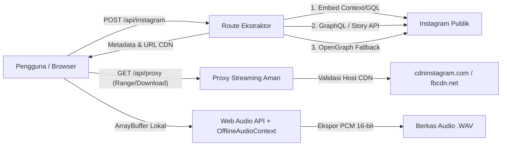

<div align="center">


# KlipGram

**Pengunduh Media Instagram Publik & Dek Ekstraksi Audio Berbasis Web**

[](https://nextjs.org/)
[](https://react.dev/)
[](https://www.typescriptlang.org/)
[](https://tailwindcss.com/)

Unduh foto resolusi asli, video, galeri *carousel*, Instagram Reels, serta Story publik tanpa *watermark*, lengkap dengan studio pemotong gelombang suara dan ekstraktor audio **PCM WAV hingga 48 kHz** langsung di browser.

</div>

---

## Daftar Isi

- [Fitur Utama](#fitur-utama)
- [Arsitektur & Alur Ekstraksi](#arsitektur--alur-ekstraksi)
- [Teknologi Utama](#teknologi-utama)
- [Memulai Cepat](#memulai-cepat)
- [Variabel Lingkungan](#variabel-lingkungan)
- [Skrip Proyek](#skrip-proyek)
- [Referensi Endpoint API](#referensi-endpoint-api)
- [Struktur Direktori](#struktur-direktori)
- [Deployment Produksi](#deployment-produksi)
- [Keamanan, Privasi & Penafian](#keamanan-privasi--penafian)

---

## Fitur Utama

- **Unduhan Multi-Format Resolusi Asli** — Mendukung tautan publik Instagram untuk foto tunggal (`/p/`), video (`/tv/`), Reels (`/reel/`, `/reels/`), galeri *carousel* multi-slide (unduh satuan maupun seluruh slide sekaligus), serta Story & Highlight (`/stories/`).
- **Dek Kaset Ekstraksi Audio (100% di Browser)** — Mendekode trek audio dari video Instagram maupun berkas video lokal (`MP4`, `MOV`, `WEBM` hingga `150 MB`) menggunakan *Web Audio API* & `OfflineAudioContext`:
  - Visualisasi gelombang audio interaktif berbasis `<canvas>` resolusi tinggi (mendukung layar Retina/HiDPI).
  - Pemotong durasi (*trimmer* titik mulai & selesai) dengan pratinjau pemutaran langsung.
  - Ekspor berkas **WAV 16-bit PCM** tanpa kompresi berlebih dalam pilihan `48 kHz Studio`, `44.1 kHz Standar`, atau `22.05 kHz Ringan` (*Stereo* maupun *Mono*).
- **Strategi Ekstraksi Bertingkat (*Multi-Fallback*)** — Menggabungkan ekstraksi *Embed Context JSON*, *GraphQL Query*, *Story Web API*, hingga *OpenGraph Metadata* agar tingkat keberhasilan pengambilan media tetap tinggi.
- **Proxy Media Streaming Anti-SSRF** — Memvalidasi domain CDN resmi Instagram (`*.cdninstagram.com`, `*.fbcdn.net`), menolak host IP privat/lokal, membatasi maksimum 4 *redirect hop* dan ukuran media `100 MB`, serta meneruskan header `Range` (`206 Partial Content`) untuk pratinjau video yang responsif.
- **Desain Retro Risograph & Maskot Klipi** — Antarmuka hangat bergaya perangkat analog dengan maskot kamera interaktif **Klipi**, efek suara mekanik sintetis (tanpa berkas audio eksternal), riwayat lokal tersinkronisasi via `useSyncExternalStore`, dan kartu pratinjau OpenGraph `1200×630` otomatis untuk WhatsApp, Telegram, dan X.

---

## Arsitektur & Alur Ekstraksi



---

## Teknologi Utama

| Lapisan | Teknologi |
| :--- | :--- |
| **Framework** | Next.js `16.4` (App Router, Turbopack, Standalone Output, `next/og`) |
| **UI & Animasi** | React `19`, Tailwind CSS `4.1`, Motion `12`, Lucide Icons |
| **Bahasa & Tipe** | TypeScript `7.0` (compiler native `tsc` via `@typescript/native`) |
| **Pemrosesan Audio** | Web Audio API (`AudioContext`, `OfflineAudioContext`, encoder RIFF WAV kustom) |
| **Kualitas Kode** | ESLint `9` (`eslint-config-next` `16.4`) + pemeriksaan tipe ketat (`strict: true`) |

---

## Memulai Cepat

### Prasyarat

- **Node.js** `>= 20.9.0` (disarankan Node.js `22` atau `24` LTS)
- **npm** `>= 10`

### Instalasi Lokal

1. **Kloning repositori & masuk ke direktori proyek:**
   ```bash
   git clone <url-repositori-anda> klipgram
   cd klipgram
   ```

2. **Pasang seluruh dependensi:**
   ```bash
   npm install
   ```

3. **Siapkan konfigurasi lingkungan lokal:**
   ```bash
   cp .env.example .env.local
   ```
   Sesuaikan nilai `APP_URL` (misalnya `http://localhost:3000` saat pengembangan lokal atau domain produksi Anda).

4. **Jalankan server pengembangan:**
   ```bash
   npm run dev
   ```
   Buka `http://localhost:3000` di browser.

---

## Variabel Lingkungan

Buat berkas `.env.local` (lihat contoh pada `.env.example`):

| Variabel | Wajib | Deskripsi |
| :--- | :---: | :--- |
| `NEXT_PUBLIC_APP_URL` / `APP_URL` | Disarankan | URL dasar publik aplikasi (contoh: `https://klipgram.cloud`) untuk membentuk URL absolut `canonical`, `og:url`, dan `og:image` pada crawler WhatsApp/sosial media. Jika kosong, aplikasi otomatis mendeteksi dari header `x-forwarded-host` / `host`. |
| `INSTAGRAM_SESSION_ID` | Opsional | Nilai cookie `sessionid` Instagram sisi server untuk membuka akses penuh ke Instagram Story publik ketika Instagram membatasi permintaan anonim. Jangan pernah mengekspos variabel ini ke sisi klien (`NEXT_PUBLIC_`). |
| `GEMINI_API_KEY` | Opsional | Kunci API Gemini apabila dijalankan pada lingkungan applet AI Studio. |
| `DISABLE_HMR` | Opsional | Setel ke `"true"` hanya jika ingin mematikan *file watcher* HMR pada lingkungan editor terotomasi. |

---

## Skrip Proyek

| Perintah | Kegunaan |
| :--- | :--- |
| `npm run dev` | Menjalankan server pengembangan Next.js dengan Turbopack. |
| `npm run typecheck` | Menjalankan pemeriksaan tipe statis penuh dengan compiler native **TypeScript 7** (`tsc --noEmit`). |
| `npm run lint` | Memeriksa kualitas dan aturan kode menggunakan ESLint. |
| `npm run build` | Membuat *production build* teroptimasi (`output: 'standalone'`). |
| `npm run start` | Menjalankan server produksi hasil `npm run build`. |
| `npm run clean` | Membersihkan direktori cache `.next`. |

> **Catatan TypeScript 7:** Proyek ini memasang compiler native TypeScript 7 (`@typescript/native` → `typescript@^7.0.2`) berdampingan dengan paket kompatibilitas `@typescript/typescript6` agar aturan analisis AST pada `eslint-config-next` (`typescript-eslint`) tetap berjalan mulus tanpa mengorbankan kecepatan `tsc` v7.

---

## Referensi Endpoint API

### 1. `POST /api/instagram`
Mengekstrak metadata dan daftar media langsung dari tautan publik Instagram.

- **Body Permintaan (`application/json`):**
  ```json
  {
    "url": "https://www.instagram.com/reel/Da277POJ5pA/"
  }
  ```
- **Respons Sukses (`200 OK`):**
  ```json
  {
    "data": {
      "shortcode": "Da277POJ5pA",
      "kind": "reel",
      "sourceUrl": "https://www.instagram.com/reel/Da277POJ5pA/",
      "username": "instagram",
      "caption": "Contoh deskripsi kiriman...",
      "items": [
        {
          "id": "Da277POJ5pA",
          "type": "video",
          "url": "https://scontent.cdninstagram.com/...",
          "thumbnailUrl": "https://scontent.cdninstagram.com/...",
          "width": 1080,
          "height": 1920,
          "durationSec": 15.4,
          "hasAudio": true
        }
      ],
      "strategy": "embed-context-json"
    }
  }
  ```
- **Kode Status Error:** `400` (URL tidak valid), `422` (media privat/kedaluwarsa atau Story membutuhkan sesi), `502` (gangguan koneksi ke upstream Instagram).

### 2. `GET /api/proxy`
Mengalirkan (*stream*) berkas media dari CDN resmi Instagram ke browser dengan header keamanan dan dukungan unduhan langsung.

- **Parameter Query:**
  - `url` *(wajib)* — URL penuh dari `*.cdninstagram.com` atau `*.fbcdn.net`.
  - `download=1` *(opsional)* — Menambahkan header `Content-Disposition: attachment` untuk memicu unduhan berkas.
  - `filename` *(opsional)* — Nama berkas keluaran yang telah disanitasi.

---

## Struktur Direktori

```text
klipgram/
├── app/
│   ├── api/
│   │   ├── instagram/route.ts   # Endpoint ekstraksi multi-strategi Instagram
│   │   └── proxy/route.ts       # Endpoint streaming proxy CDN aman (anti-SSRF)
│   ├── globals.css              # Token warna & tipografi Tailwind CSS v4
│   ├── layout.tsx               # Root layout, font Google, & metadata OpenGraph dinamis
│   ├── opengraph-image.tsx      # Generator kartu gambar OG 1200x630 bertema retro
│   └── page.tsx                 # Halaman utama aplikasi
├── components/
│   ├── AudioStudio.tsx          # Dek kaset Web Audio API, waveform canvas, & ekspor WAV
│   ├── DownloaderWorkbench.tsx  # Meja kerja utama pengunduh, carousel, & riwayat lokal
│   ├── EditorialSections.tsx    # Bento fitur, panduan singkat, FAQ, & footer
│   ├── Navbar.tsx               # Navigasi sticky bergaya tombol mekanik retro
│   └── RetroMascot.tsx          # Maskot interaktif Klipi dengan status reaktif
├── hooks/
│   └── use-mobile.ts            # Hook deteksi viewport responsif
├── lib/
│   ├── audio-extractor.ts       # Dekoder ArrayBuffer, kalkulasi puncak gelombang, & encoder WAV
│   ├── instagram.ts             # Validasi URL ketat, sanitasi nama berkas, & helper format
│   ├── retro-sfx.ts             # Sintesis efek suara klik & jingle retro via OscillatorNode
│   └── utils.ts                 # Utilitas penggabungan kelas Tailwind
├── public/
│   └── og-mascot.jpg            # Aset maskot teroptimasi untuk kartu OpenGraph
├── next.config.ts               # Konfigurasi Next.js 16 (standalone + Turbopack)
├── package.json                 # Daftar dependensi & skrip proyek
└── tsconfig.json                # Konfigurasi ketat TypeScript 7
```

---

## Deployment Produksi

Proyek telah dikonfigurasi menggunakan `output: 'standalone'` di `next.config.ts` sehingga siap dijalankan pada berbagai platform:

1. **Vercel / Platform Serverless**
   - Hubungkan repositori, tambahkan `NEXT_PUBLIC_APP_URL=https://domain-anda.com` (dan opsional `INSTAGRAM_SESSION_ID`), lalu jalankan deploy.
2. **Docker / Cloud Run / VPS Node.js**
   ```bash
   npm ci
   npm run build
   cp -r public .next/standalone/public
   cp -r .next/static .next/standalone/.next/static
   PORT=3000 node .next/standalone/server.js
   ```
3. **Pembaruan Cache Pratinjau WhatsApp**
   - Pastikan domain menggunakan HTTPS publik. Jika pratinjau tautan lama masih tersimpan di cache WhatsApp setelah pembaruan, bagikan URL dengan parameter versi baru seperti `https://domain-anda.com/?v=2`.

---

## Keamanan, Privasi & Penafian

- **Privasi Pengguna:** KlipGram tidak menyimpan berkas foto, video, rekaman audio, maupun riwayat unduhan pengguna di server. Riwayat tautan terakhir disimpan sepenuhnya di `localStorage` browser masing-masing pengguna dan dapat dihapus kapan saja.
- **Perlindungan Server (Anti-SSRF):** Seluruh permintaan keluar divalidasi ketat terhadap daftar putih domain resmi Instagram/CDN Meta, menolak alamat IP lokal/internal, kredensial URL, port non-standar, serta tipe konten non-media (`X-Content-Type-Options: nosniff`).
- **Penafian Hukum:** KlipGram adalah proyek alat bantu independen dan **tidak berafiliasi, disponsori, atau didukung oleh Instagram maupun Meta Platforms, Inc.** Gunakan aplikasi ini secara bijak hanya untuk mengarsipkan konten publik atau materi yang Anda miliki hak/izin penggunaannya.
